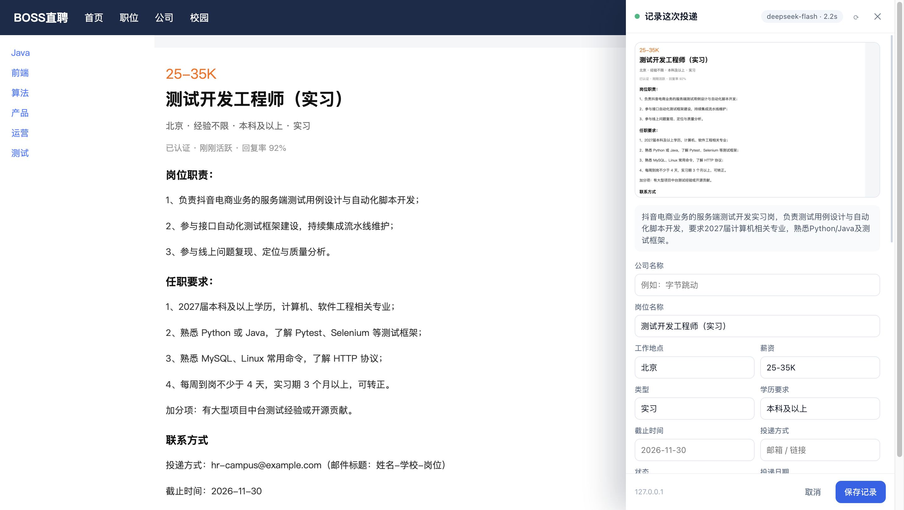
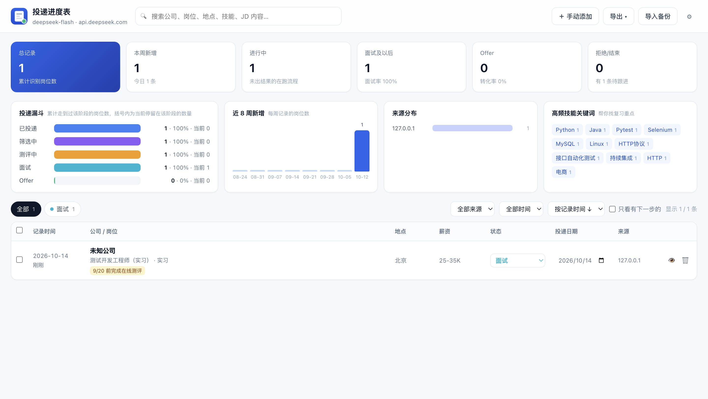
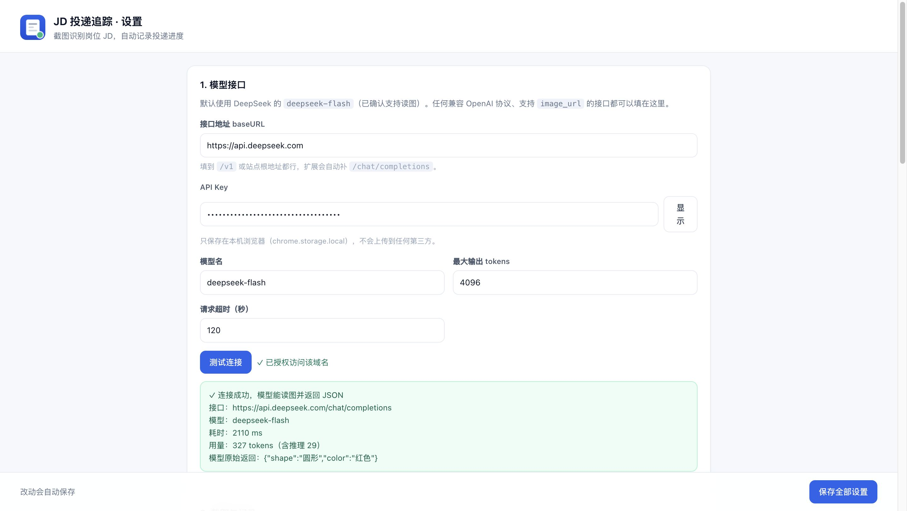
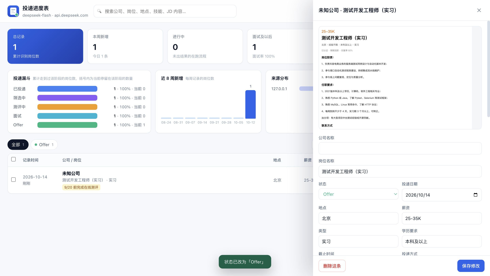

# JD 投递追踪 · Chrome 扩展

在招聘网站上圈一下 JD，截图交给大模型识别，自动变成一条带时间的投递记录；之后在进度表里跟踪状态、看统计。

面向秋招/实习投递：不用再手动把岗位信息复制到 Excel，圈一下 JD 就记下来了。

| 页内审阅面板 | 投递进度表 |
| --- | --- |
|  |  |

| 弹窗快捷入口 | 设置页 |
| --- | --- |
|  |  |

---

## 一、三步上手

1. **装扩展** —— 打开 `chrome://extensions`（Edge 用 `edge://extensions`），右上角打开 **开发者模式**，点 **加载已解压的扩展程序**，选中本目录。
2. **填 API Key** —— 安装后会自动打开设置页，按下节填好接口地址和 Key，点 **测试连接** 确认能读图。
3. **圈 JD 记一条** —— 打开招聘岗位页面，按 `Alt+Shift+J` 拖拽圈出 JD 区域，3-10 秒后页面右侧弹出审阅面板，核对字段后点 **保存记录**。

装好后如果没自动弹设置页，点扩展图标 → 右上角 ⚙ 进设置。

> 加载的目录要一直保留在这个位置，移动或删除后扩展会失效。
> 也可以把 `dist/job-tracker-extension-1.0.0.zip` 解压后再加载；zip 只是方便传输，不能直接拖进浏览器。

## 二、首次配置（只需一次）

在设置页填写这三项：

| 项 | 值 |
| --- | --- |
| 接口地址 | `https://api.deepseek.com` |
| API Key | 你自己的 DeepSeek Key（`sk-…`） |
| 模型名 | `deepseek-flash` |

然后点 **测试连接**。出现「✓ 连接成功，模型能读图并返回 JSON」就说明地址、Key、模型、读图能力四项都通。

- **关于 `deepseek-flash`**：这个模型默认声明的输入模态只有 text，但实测（`https://api.deepseek.com`）能正确读取中文 JD 截图，返回结构化字段，单张图约 2-4 秒、1500-2000 tokens。设置页的「测试连接」会直接回显模型的原始返回，可以自己确认它真的"看"到了图。
- **用别的模型也可以**：任何兼容 OpenAI 协议、支持 `image_url` 的接口都能用（OpenRouter、各类中转、z.ai 等），改接口地址即可。换非默认域名时，设置页会提示点一下 **授权访问该域名**，扩展才有权限访问该接口。
- **API Key 只存在本机** 浏览器的 `chrome.storage.local` 里，不会同步到云端，也不会上传到除你自己配置的接口以外的任何地方。

## 三、怎么用

### 两种识别方式

| 操作 | 说明 |
| --- | --- |
| 点扩展图标 → **框选识别 JD** | 拖拽圈出 JD 区域，精确、识别质量最好，也最省 token |
| `Alt+Shift+J` | 同「框选识别」，不用开弹窗 |
| Alt+Shift+K（或弹窗 → **整屏识别 JD**） | 直接截当前整屏送识别，一步到位 |
| 右键网页 → **记录这个岗位** | 同上两种模式，在右键菜单里选 |

两种方式都只截**当前可见屏幕**，所以 JD 太长时先滚动到关键区域再圈选。

### 识别流程

圈选 → 页面里弹出「正在识别」→ 3-10 秒后右侧出现审阅面板 → 核对/修改字段 → 保存。

审阅面板里可以直接改公司、岗位、地点、薪资、类型、学历、截止时间、投递方式、**状态**、投递日期、下一步、技能关键词、JD 正文、任职要求、备注。识别结果有偏差就在这一步改掉，不用去别的地方编辑。识别过程中可以随时「取消识别」。

### 重复提醒

如果同一个公司+岗位已经记录过，面板顶部会提示已有记录，可以选择「仍然保存为新记录」或直接打开进度表查看。

## 四、投递进度表

点弹窗里的「打开进度表」，或按 `Alt+Shift+L`。



- **总览卡片**：总记录 / 本周新增 / 进行中 / 面试及以后（面试率）/ Offer（转化率）/ 拒绝结束（含待跟进数）
- **投递漏斗**：累计走到过每个阶段的岗位数 + 百分比 + 当前停留在该阶段的数量
- **近 8 周新增**、**来源分布**、**高频技能关键词**（帮你找复习重点，点关键词可直接筛选）
- **表格**：行内直接改**状态**和**投递日期**，双击行打开详情抽屉
- **详情抽屉**：原始截图、完整 JD、任职要求、状态时间线（每次改状态都会留痕）、识别用时与 token 用量
- **筛选**：全文搜索（含 JD 内容）、状态多选、来源、时间范围、只看有下一步的
- **批量**：勾选多条 → 批量改状态 / 批量删除
- **手动添加**：没截图也能补一条记录
- **导出**：CSV（Excel 直接打开不乱码）/ Markdown / JSON 完整备份（含截图）/ 复制 Markdown 到剪贴板

导出的 Markdown 是「公司 | 岗位 | 状态 | 投递时间 | 记录时间 | 地点 | 薪资 | 下一步 | 备注」表格 + 状态变化明细 + 岗位详情，可以直接粘进笔记或表格工具。

### 状态词表

默认 7 个状态：

`已投递` · `筛选中` · `测评中` · `面试` · `Offer` · `拒绝/已结束` · `待确认`

在设置页可以按 `名称|颜色` 的格式自由增删改。

## 五、设置项说明

- **截图最长边 / JPEG 质量**：默认 1800px / 0.9。调大更清晰但更慢更贵。
- **最多保留截图条数**：默认 300 条，超出后只删旧截图，记录本身保留。
- **保存截图**：关掉后只存文字，省空间。
- **默认状态**：新记录初始状态，默认「已投递」。
- **保存后自动关闭面板 / 自动打开进度表**。
- **识别提示词**：可以完全自定义让模型抽哪些字段（占位符 `{{pageTitle}}`、`{{pageUrl}}` 会自动作为辅助上下文）。
- **数据**：导出全部数据（JSON/CSV/Markdown）、导入 JSON 备份（按 id 覆盖、按公司+岗位去重）、清空全部记录（需输入「清空」二次确认）、查看存储占用。

## 六、数据与隐私

- 所有记录、截图、API Key 都存在本机 `chrome.storage.local`，不上传任何服务器。
- 只有被识别的**截图**会发给你自己配置的模型接口，请求体里带 `Authorization: Bearer <你的 Key>`。
- 导出的 JSON 备份包含截图（base64），注意别误传到公开仓库；CSV/Markdown 不含截图。

## 七、常见问题

**提示「还没有配置 API Key」** —— 打开设置页填好 Key；安装后设置页会自动打开一次。

**测试连接报 401/403** —— Key 不对或没有该模型权限，回设置页检查；报 404 则是「接口地址」或「模型名」写错了。

**提示模型不接受图片输入** —— 当前模型不支持视觉，换一个支持 `image_url` 的模型。

**识别出来是空的** —— 模型偶发空返回时扩展会自动重试一次；两次都空说明圈选范围内可能没有文字，重新圈一次，或圈小一点、圈得更准。

**识别很慢或很贵** —— 调小设置里的「截图最长边」，或者框选时只圈 JD 正文而不是整屏。

**截图失败 / 无法截图** —— 浏览器内置页面（`chrome://`、扩展页、应用商店页）不允许截图，换普通网页；本地文件页面（`file://`）需要在 `chrome://extensions` 里为本扩展开启「允许访问文件网址」。

**整页长截图支持吗** —— 不支持，扩展只截当前可见区域，用「整屏 + 框选」组合覆盖；JD 太长就分两次记。

## 八、目录结构

```
manifest.json              MV3 清单（权限、快捷键、右键菜单）
src/background.js          service worker：截图、调用接口、消息路由、落库
src/content/overlay.js     页内 UI：框选 + 识别中 + 审阅面板（Shadow DOM 隔离）
src/lib/settings.js        默认设置、状态词表、URL 归一化
src/lib/store.js           记录 CRUD、去重、统计、导出格式
src/lib/vision.js          提示词、接口调用、JSON 抽取、字段归一化、空返回重试
src/lib/util.js            时间、来源识别、技能词典、CSV 等工具
src/popup/                 弹窗：快捷识别入口 + 最近记录 + 状态快改
src/dashboard/             进度表：统计、筛选、表格、详情抽屉、导入导出
src/options/               设置：接口、截图、状态词表、提示词、数据
scripts/                   图标生成、自检、真实浏览器 e2e、测试用招聘页
docs/                      样例截图、界面截图
```

## 九、开发与自检

```bash
# 核心逻辑自检（含真实接口调用）
node scripts/selftest.mjs --from-zcode        # 从 ~/.zcode/v2/config.json 找 deepseek-flash 的 key
JDT_API_KEY=sk-xxx node scripts/selftest.mjs  # 或直接给 key
node scripts/selftest.mjs --image ./shot.jpg  # 换自己的截图

# 真实浏览器端到端测试（隔离 profile，不会碰你正在用的浏览器）
node scripts/e2e-cdp.mjs --from-zcode
```

`selftest.mjs` 覆盖 URL 归一化、JSON 抽取容错、字段别名映射、空返回重试、落库、状态时间线、统计漏斗、CSV/Markdown/JSON 导出、导入去重，并用真实接口跑一张样例图。

`e2e-cdp.mjs` 会启动一个安装了本扩展的 Chromium，走完「截图 → 框选 → 识别 → 改状态 → 保存 → 看板统计 → 抽屉 → 搜索 → 设置页 → 连通性测试 → popup」全流程，并把各界面截图写到 `tmp/e2e/`。

> 注意：Google Chrome 从 137 起忽略 `--load-extension` 开关，所以 e2e 会自动优先找 Playwright 的 Chromium（`~/Library/Caches/ms-playwright/`）。这**只影响自动化测试**，手动「加载已解压的扩展程序」不受影响。
> 测试脚本会把扩展复制到临时目录、只在副本的 manifest 里加 `<all_urls>`（无头环境没有工具栏可点，无法产生 activeTab），交付目录里的 manifest 不会被改动。
